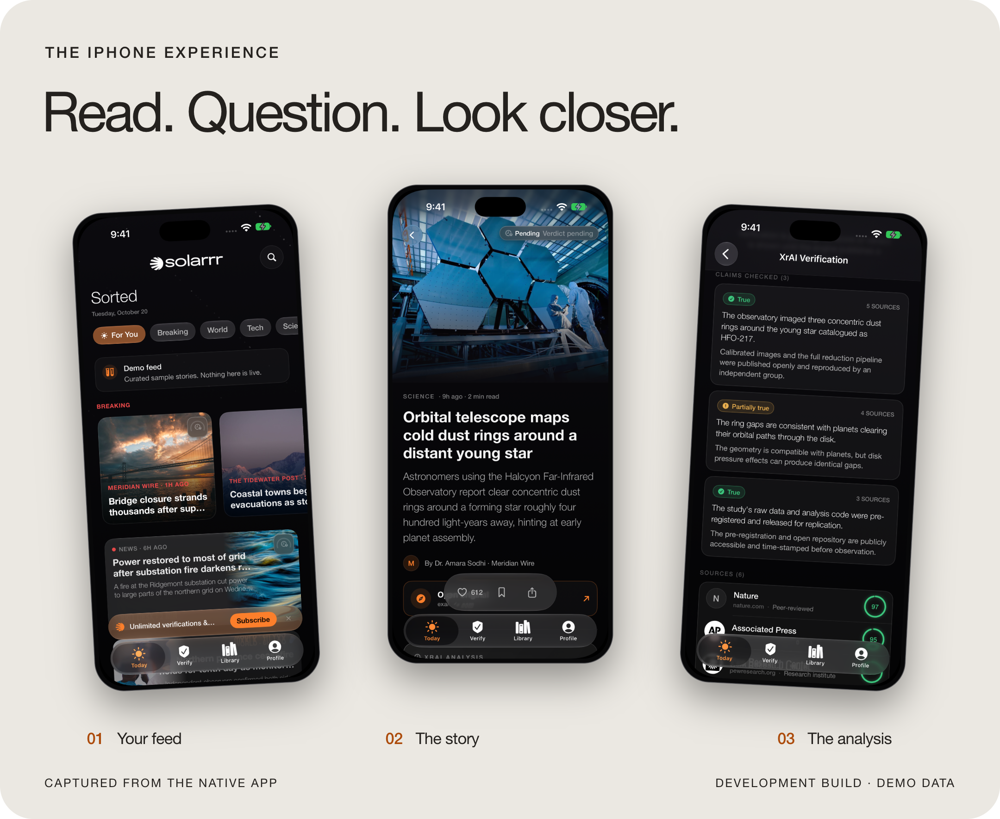
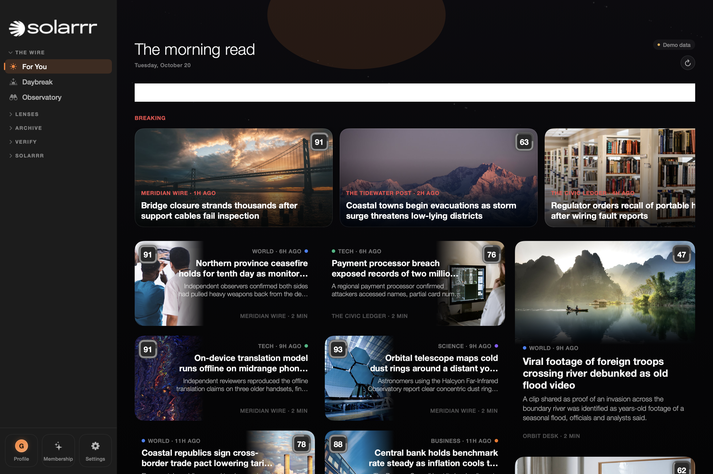
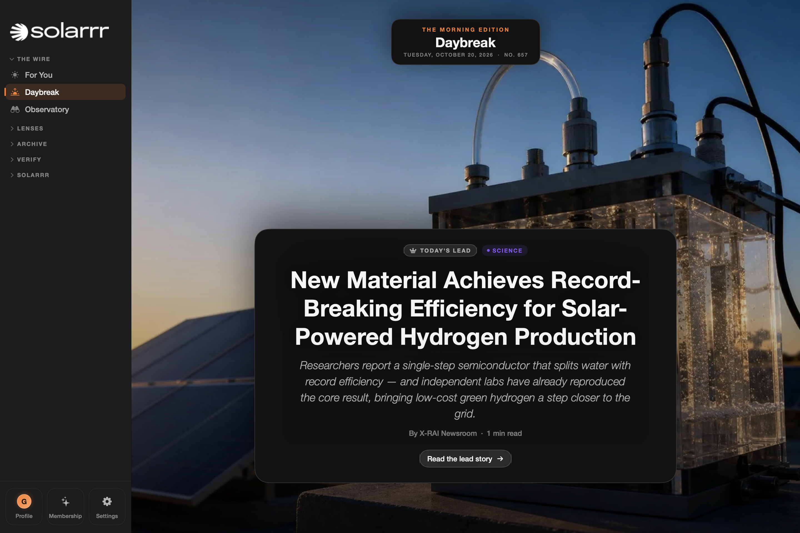

[← Solarrr](README.md) &nbsp;·&nbsp; [How verification works](VERIFICATION.md)

# Inside Solarrr.

A closer look at the native apps. Every screen below was captured from a development build with demonstration content.

## On iPhone

### Read, then look closer.

Start with your feed. Open the article. Bring its analysis into view without losing the story you came to read.

<picture>
  <source media="(max-width: 700px)" srcset="assets/reading-mobile.png">
  
</picture>

[Feed](assets/screens/iphone-feed.png) &nbsp;·&nbsp; [Reader](assets/screens/iphone-reader.png) &nbsp;·&nbsp; [Analysis](assets/screens/iphone-analysis.png)

### Check something of your own.

Choose a link, a written claim, or text extracted from an image. Review the report and return to previous checks through the app's history. The availability of history and other features depends on the account and plan.

<picture>
  <source media="(max-width: 700px)" srcset="assets/verification-mobile.png">
  
</picture>

[What the assessment means →](VERIFICATION.md)

## On Mac

### A workspace for a wider view.

The native Mac app gives the story, its context and the reading tools more space. Move between news, verification and the library from a persistent sidebar.

### Another way into the day.

Daybreak gives the day's lead story its own space within the Mac workspace.

## In the browser

The Web app is being developed around a searchable story archive, dedicated article pages and saved reading. The public introduction and waitlist live at [solarrr.app](https://solarrr.app).

The Web app is not pictured here; the screenshots on this page are native iPhone and Mac captures.

## The small things matter.

Readable article surfaces. A clear distinction between orange brand accents and verdict colours. Source links that take you beyond the label. Explicit uncertainty when a result is unavailable.

These are the principles behind Solarrr's reading experience. Feature parity, distribution and release availability are still in development.

---

[Back to Solarrr →](README.md) &nbsp;·&nbsp; [Follow the evidence →](VERIFICATION.md)
