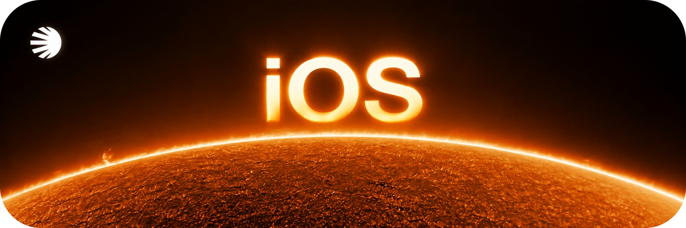
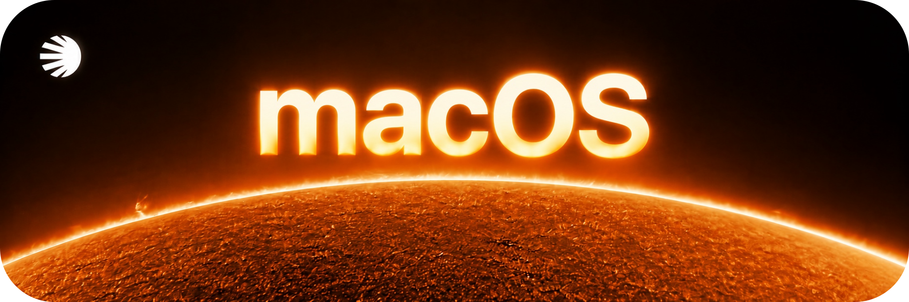
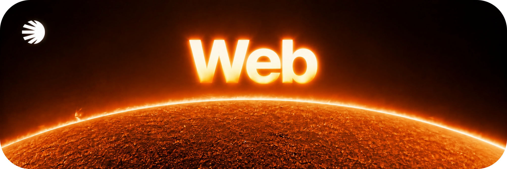

[← SOLARRR](README.md)

# The experience

SOLARRR is in development across iOS, macOS and the web.

## iOS

A native reading experience for iPhone.

- Browse the daily feed by topic and open individual stories.
- Check links, written claims and text extracted from images.
- Inspect verification reports, checked claims and supporting sources.
- Return to saved stories and previous checks in your library.

## macOS

A native workspace for reading across a larger canvas.

- Follow topics and outlets.
- Read articles alongside verification and source information.
- Explore related stories.
- Revisit saved work through the library and constellation views.

## Web

A browser reading app for exploring the news.

- Browse and search the story archive.
- Open dedicated article pages.
- Save stories for later.

## Behind the reading

**Core** gives the Apple apps a shared foundation for their reading and verification features.

**Engine** supports news processing and verification. A useful assessment should leave room to inspect its sources and understand what was checked.

## The public site

[Visit solarrr.app →](https://solarrr.app)

The landing page is available now. App distribution and feature availability will be communicated separately.

---

[Back to SOLARRR](README.md) · [Jacopo Tonti](https://github.com/jacopotontii)
