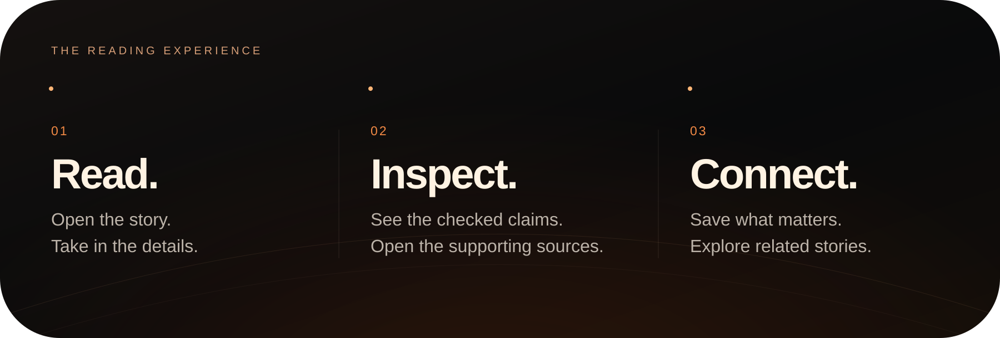
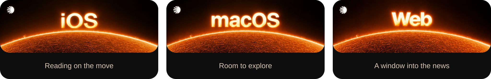
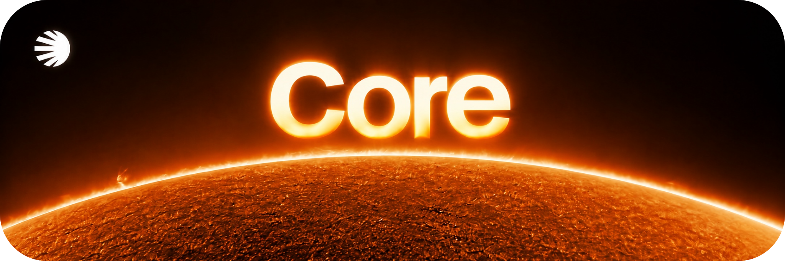
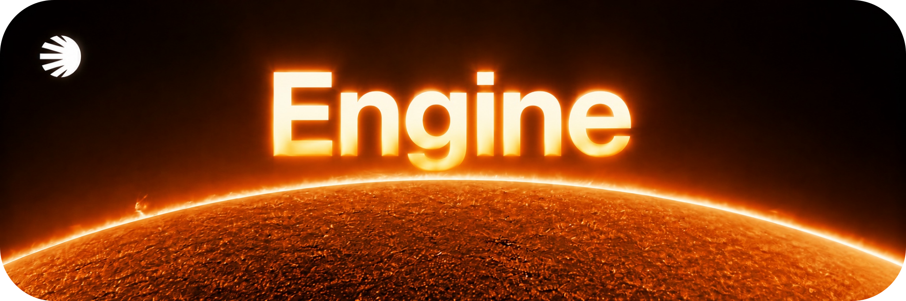
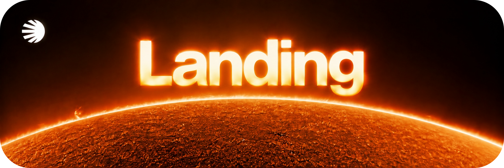

  <a href="https://solarrr.app">
    <picture>
      <source media="(prefers-reduced-motion: no-preference)" srcset="assets/solarrr-motion.svg">
      
    </picture>
  </a>

<h1 align="center">A brighter way to read the news.</h1>

  Stories, sources and context. 
  A news reading experience in development for iOS, macOS and the web.

  

  <a href="#the-experience">The experience</a> &nbsp;·&nbsp;
  <a href="#one-product-three-ways-in">The platforms</a> &nbsp;·&nbsp;
  <a href="#follow-the-project">Follow the project</a>

 

## The experience

Read a story. Inspect its supporting sources. Keep the wider context in view.

<picture>
  <source media="(max-width: 900px)" srcset="assets/reading-mobile.svg">
  
</picture>

The native apps bring article reading, saved stories and verification reports together. Check a link, a written claim or text from an image, then explore the evidence behind the result.

 

## One product. Three ways in.

<a href="EXPERIENCE.md">
  <picture>
    <source media="(max-width: 900px)" srcset="assets/platforms-mobile.svg">
    
  </picture>
</a>

**iOS** for reading and checking on the move. **macOS** for a broader reading workspace. **Web** for exploring the archive in a browser.

[Explore the platforms →](EXPERIENCE.md)

<strong>Under the surface</strong>

 

  &nbsp;
  

**Core** is the shared foundation of the Apple apps. **Engine** supports news processing and verification. Readers can inspect the supporting claims and sources instead of treating an assessment as the end of the story.

 

## Follow the project

The public site introduces SOLARRR and its waitlist. Visit it for the current presentation, or star this showcase to keep the project close.

  <a href="https://solarrr.app"><strong>solarrr.app ↗</strong></a>  
  By <a href="https://github.com/jacopotontii">Jacopo Tonti</a>

---

Public product showcase. The applications are in development; their source is maintained privately.
