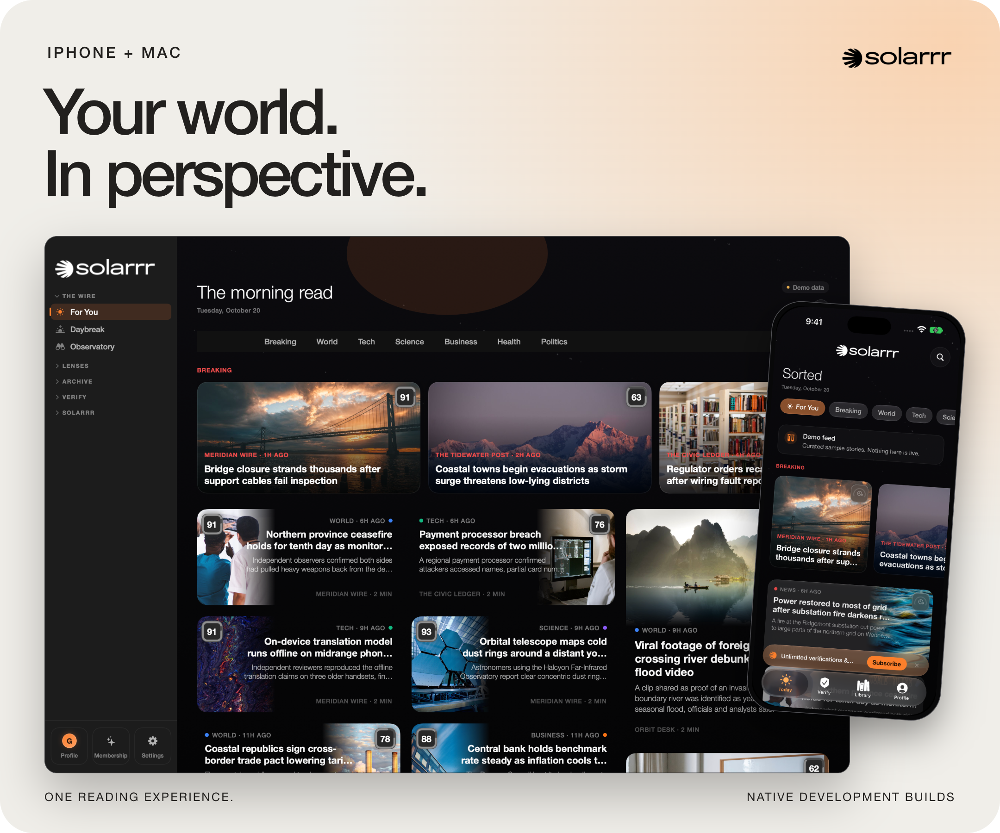
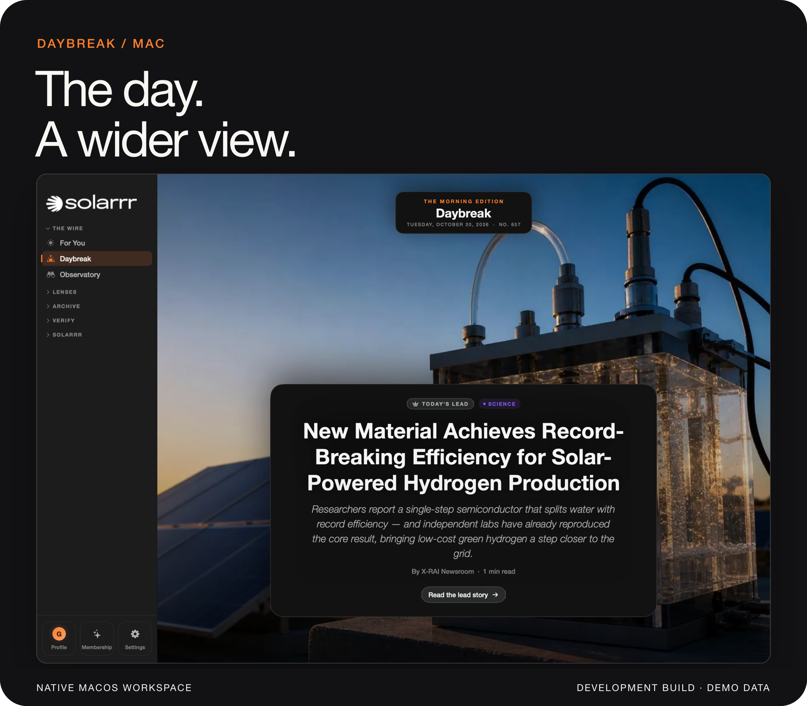

  

<h1 align="center">A brighter way to read the news.</h1>

  Read the story. Question the claim. Explore the evidence. 
  Solarrr brings news and verification into one reading experience.

  <a href="EXPERIENCE.md"><strong>Inside Solarrr</strong></a> &nbsp;·&nbsp;
  <a href="VERIFICATION.md"><strong>How verification works</strong></a> &nbsp;·&nbsp;
  <a href="https://solarrr.app"><strong>Visit solarrr.app ↗</strong></a>

 

## From the headline to the evidence.

Follow the subjects you care about. Open a story, read its analysis, and follow the sources behind its claims. Save what matters and come back with more context.

<a href="EXPERIENCE.md">
  <picture>
    <source media="(max-width: 700px)" srcset="assets/product-mobile.png">
    
  </picture>
</a>

Captured from the native development builds. Stories and assessments shown are demonstration data.

 

## Bring your own question.

A link you have been sent. A claim you have read. Text in a screenshot. Start a check, then look beyond the result: which claims were examined, which sources support them, and what remains uncertain.

<a href="VERIFICATION.md">
  <picture>
    <source media="(max-width: 700px)" srcset="assets/evidence-mobile.png">
    
  </picture>
</a>

**The evidence is part of the answer.** A verdict gives you a starting point. The report gives you something to examine.

[See how a check works →](VERIFICATION.md)

 

## More room for perspective.

A story rarely exists on its own. Solarrr's desktop workspace brings reading, verification and related stories into a wider view. The library offers another way back into the material you have saved.

[Explore the native apps →](EXPERIENCE.md)

 

## Three ways in.

| | Built around | Availability |
| :--- | :--- | :--- |
| **iPhone** | A personal feed, article reading, link and claim checks, text recognition from images, and a saved library. | In development |
| **Mac** | A larger reading workspace, verification reports, related stories and visual library views. | In development |
| **Web** | Browsing and searching the story archive, article pages, and saved reading. | In development |

The Apple apps share a common foundation. The Engine processes the news and verification results; the apps present the assessment and its evidence. Features and availability differ by platform.

<strong>What is available today?</strong>

The public site at [solarrr.app](https://solarrr.app) introduces the project and its waitlist. App distribution, release dates and pricing are not announced by this repository.

The images here are captures of development software using demonstration content. They show the interface, not live news or independently validated assessments. [About these images](design/README.md#captures).

This repository presents the product. Application source code is maintained privately.

 

  <strong>Stay close to Solarrr.</strong> 
  Explore the project and join the waitlist at <a href="https://solarrr.app">solarrr.app ↗</a>

Created by <a href="https://github.com/jacopotontii">Jacopo Tonti</a>.

