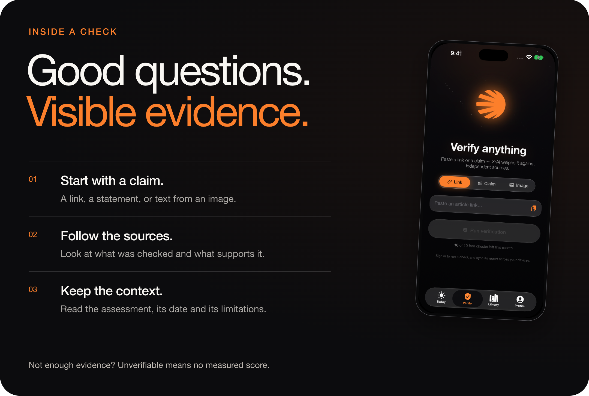
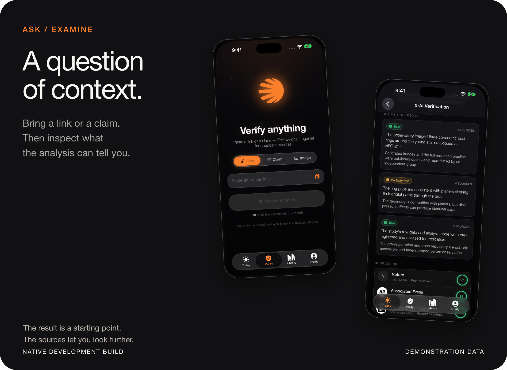

[← Solarrr](README.md) &nbsp;·&nbsp; [Inside the apps](EXPERIENCE.md)

# Follow the evidence.

Solarrr brings AI-assisted verification into the reading experience. The useful part is being able to examine the claims and sources behind an assessment.

<picture>
  <source media="(max-width: 700px)" srcset="assets/evidence-mobile.png">
  
</picture>

## 01 · Start with something specific.

**Link.** Submit the address of the story you want to check.

**Claim.** Write or paste the statement you want examined.

**Image.** The iPhone app can recognize text in a photo or screenshot. That extracted text enters the verification flow; this is not a forensic test of the image itself.

## 02 · Open the report.

A useful check should make it possible to ask:

- **What was checked?** Read the individual claims, rather than relying only on an overall label.
- **What supports it?** Open the cited sources and compare their wording and context.
- **How current is it?** Look for the check's date when one is available. Evidence can change.
- **What is missing?** Read the limitations. An unavailable result should remain unavailable.

<picture>
  <source media="(max-width: 700px)" srcset="assets/verification-mobile.png">
  
</picture>

Development interface with demonstration content. The pictured assessment is not a live fact-check.

## 03 · Read the assessment in context.

Solarrr's Engine defines five verdict labels:

| Verdict | How to read it |
| :--- | :--- |
| **Verified** | The assessment supports the checked claim. Inspect the supporting evidence. |
| **Mostly true** | The assessment is broadly supportive; qualifications still matter. |
| **Misleading** | Framing, omissions or context affect how the claim should be understood. |
| **False** | The assessment finds the checked claim unsupported or contradicted. Read its reasoning. |
| **Unverifiable** | The assessment cannot establish a result. **There is no measured score.** |

These are assessment labels, not guarantees. AI-assisted verification can miss context or make mistakes. The source material and the scope of the check matter more than a number in isolation.

## One result, carried consistently.

The Engine supplies the canonical assessment. The native apps display it; they do not invent a replacement score from the article text or a missing value. Missing dates and scores remain missing. An unverifiable result is not converted into a neutral-looking score.

For machine-generated news, the source material and the finished article are assessed separately. The article's displayed score belongs to the finished article, not automatically to the source it drew on.

---

[Explore the apps →](EXPERIENCE.md) &nbsp;·&nbsp; [Visit Solarrr ↗](https://solarrr.app)
